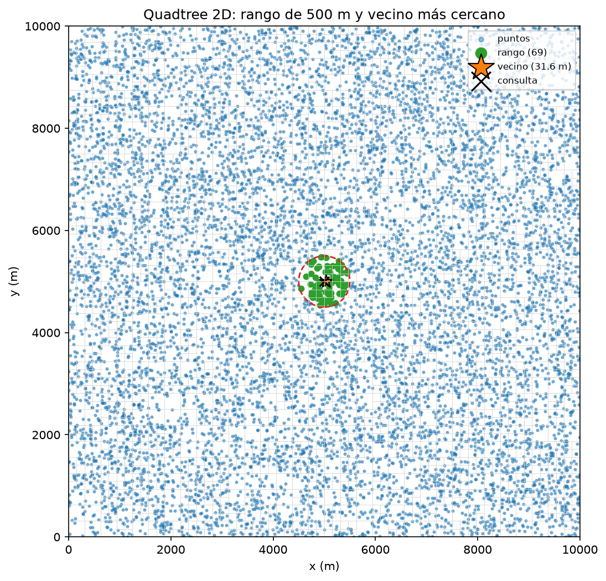
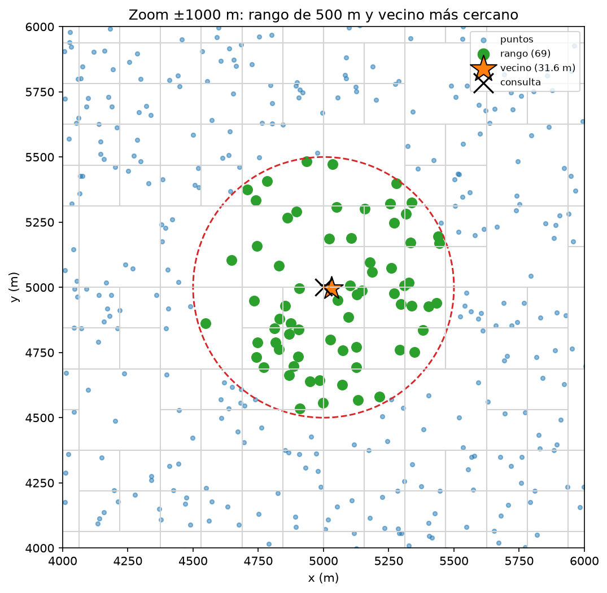
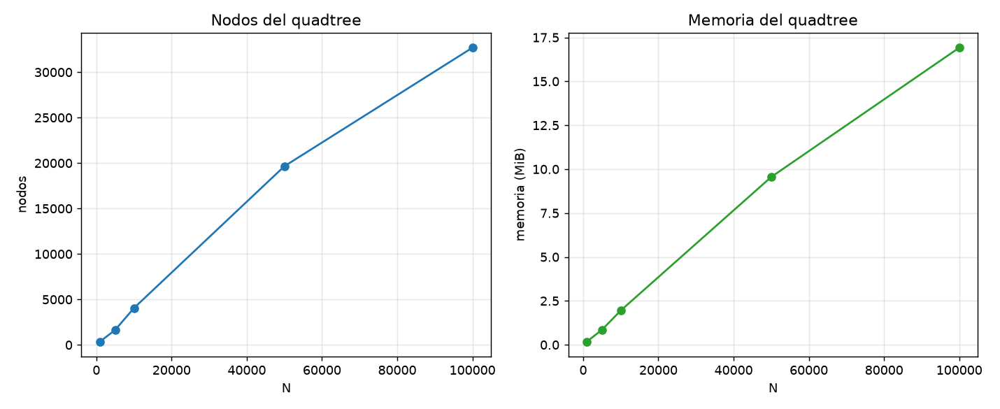
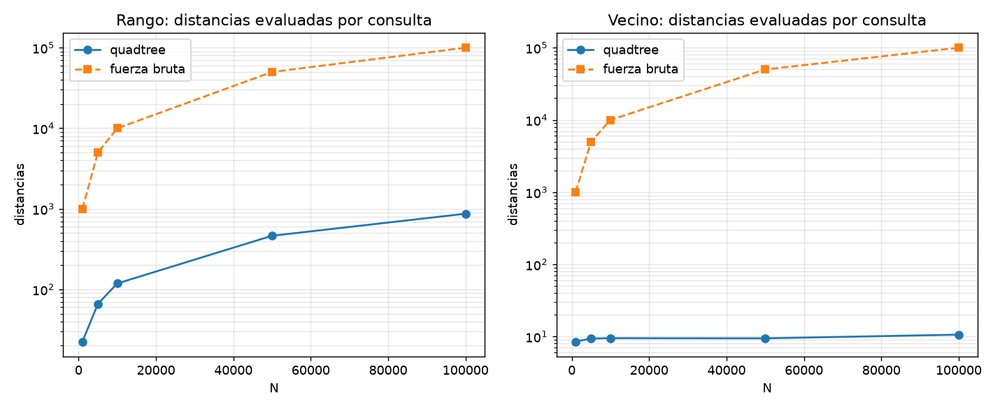
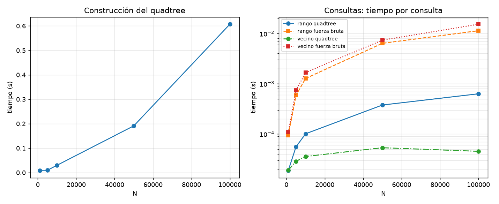

# Proyecto: Implementación de un Quadtree 2D para Entregas de Logística

**Estudiante:** Simón Montoya

---

## 1. Objetivos del Experimento

- **Implementación:** Construir desde cero un Quadtree 2D en Python para organizar 10.000 puntos de entrega en un área de 10.000 m × 10.000 m.
- **Consultas espaciales:** Implementar búsquedas de rango con un radio de 500 metros y búsqueda del vecino más cercano.
- **Comparación experimental:** Evaluar el rendimiento del Quadtree frente a la fuerza bruta mediante tiempos de ejecución, distancias evaluadas y nodos visitados.
- **Validación:** Comprobar que ambas implementaciones produzcan resultados exactos.

---

## 2. Entorno Experimental

### 2.1 Hardware

- **Procesador:** 12th Gen Intel(R) Core(TM) i5-12500H @ 2.50 GHz.
- **Memoria RAM:** 16 GB.
- **Arquitectura:** Sistema operativo de 64 bits, basado en x64.

### 2.2 Software y Librerías

- **Sistema Operativo:** Windows 11 Home / Pro.
- **Lenguaje:** Python 3.13.2.
- **Librerías:**
  - `matplotlib`: Visualización de puntos, divisiones y consultas.
  - `time`: Medición de tiempos de ejecución.
  - `tracemalloc`: Medición del consumo de memoria.
  - `unittest`: Pruebas unitarias.

La implementación del Quadtree y los algoritmos de búsqueda se realizaron desde cero, sin utilizar estructuras espaciales externas.

---

## 3. Metodología Experimental y Diseño de Pruebas

### 3.1 Generación de Datos

Se generaron puntos aleatorios que representan ubicaciones de entregas dentro de un área de 10.000 m × 10.000 m.

Se utilizaron semillas fijas:

- **Puntos:** `SEMILLA = 42`.
- **Consultas:** `SEMILLA = 43`.
- **Radio de búsqueda:** 500 metros.

Para evaluar el comportamiento al aumentar la cantidad de datos, se realizaron pruebas con `N = 1.000, 5.000, 10.000, 50.000 y 100.000` puntos.

### 3.2 Implementación de los Algoritmos

Se desarrollaron dos alternativas:

- **Quadtree 2D:** Divide el espacio en cuatro cuadrantes y permite descartar regiones que no contienen posibles resultados. Cada hoja tiene una capacidad inicial de 8 puntos y una profundidad máxima de 20 niveles.
- **Fuerza bruta:** Recorre todos los puntos para resolver las mismas consultas, sirviendo como referencia para comparar resultados y rendimiento.

Se implementaron dos operaciones:

1. **Consulta de rango:** Encuentra todos los puntos dentro de un radio de 500 metros.
2. **Vecino más cercano:** Identifica el punto con menor distancia respecto a una ubicación de consulta.

Para optimizar los cálculos se utiliza la distancia euclidiana al cuadrado, evitando raíces cuadradas innecesarias. También se aplica un criterio de desempate consistente en ambas implementaciones.

### 3.3 Métricas y Validación

Se registraron las siguientes métricas:

- **Tiempo de construcción:** Duración de la creación del Quadtree.
- **Tiempo de consulta:** Promedio de ejecución de cada búsqueda.
- **Distancias evaluadas:** Cantidad de comparaciones realizadas contra puntos reales.
- **Nodos visitados:** Cantidad de nodos recorridos durante las consultas.
- **Consumo de memoria:** Memoria utilizada durante la construcción del árbol.

El análisis utiliza 50 consultas por tamaño de entrada. Además, se realizaron pruebas unitarias con `unittest` y comparaciones exactas contra fuerza bruta en 150 consultas para cada uno de los tamaños `1.000`, `5.000` y `10.000`.

---

## 4. Estructura del Proyecto e Instrucciones de Ejecución

### 4.1 Organización de Archivos

```text
Proyecto_Quadtree/
│
├── generador_datos.py    # Generación de puntos y consultas
├── fuerza_bruta.py       # Algoritmos de búsqueda tradicionales
├── quadtree.py           # Implementación de Nodo y QuadTree
├── test.py               # Pruebas unitarias
├── visualizacion.py      # Representación gráfica
├── analisis.py           # Experimentos y generación de gráficas
├── main.py               # Ejecución general del proyecto
│
└── graficas/
    ├── tamano.png
    ├── distancias.png
    ├── tiempos.png
    └── visualizacion.png
```


## 5. Análisis de Resultados y Conclusiones

### 5.1 Resultados del Experimento

Los siguientes valores corresponden al promedio de 50 consultas por tamaño de entrada.

| N | Nodos | Memoria (MiB) | Construcción (s) | Rango QT (µs) | Rango FB (µs) | Vecino QT (µs) | Vecino FB (µs) |
|---:|---:|---:|---:|---:|---:|---:|---:|
| 1.000 | 369 | 0,18 | 0,0013 | 20,0 | 85,2 | 15,5 | 87,2 |
| 5.000 | 1.645 | 0,85 | 0,0088 | 37,1 | 471,9 | 35,2 | 650,6 |
| 10.000 | 4.049 | 1,95 | 0,0200 | 66,9 | 778,1 | 24,8 | 1.102,7 |
| 50.000 | 19.649 | 9,55 | 0,1551 | 312,3 | 4.429,3 | 30,1 | 6.812,1 |
| 100.000 | 32.689 | 16,91 | 0,3474 | 574,6 | 11.284,1 | 32,0 | 12.783,3 |

### 5.2 Análisis y Conclusiones

1. **Fuerza bruta:** Su tiempo de ejecución crece con la cantidad de puntos, ya que debe recorrerlos todos para responder cada consulta.

2. **Consultas de rango:** El Quadtree reduce las distancias evaluadas mediante la poda espacial. Sin embargo, al aumentar la densidad de puntos, también aumenta la cantidad de resultados dentro del radio de búsqueda.

3. **Vecino más cercano:** La exploración priorizada de los cuadrantes cercanos permite encontrar rápidamente un candidato y descartar gran parte del árbol. Para 100.000 puntos, esta consulta es aproximadamente 400 veces más rápida que la fuerza bruta.

4. **Construcción y memoria:** Ambas métricas aumentan con el tamaño de entrada. Para 100.000 puntos, la construcción tarda aproximadamente 0,35 segundos y el consumo medido es de 16,91 MiB.

5. **Exactitud:** Las pruebas confirmaron que las consultas del Quadtree coinciden con las de fuerza bruta, demostrando que la poda reduce el trabajo sin alterar los resultados.

**Limitaciones:** La implementación trabaja con datos estáticos, no contempla rebalanceo y puede presentar un comportamiento lineal en casos donde la distribución de puntos impide una poda efectiva, como ocurre con muchos puntos duplicados.

En conclusión, los resultados muestran que el Quadtree es una alternativa eficiente para las consultas espaciales, especialmente cuando se necesita encontrar vecinos cercanos en conjuntos de datos grandes.

---
---

##  Visualización de Resultados

Las siguientes gráficas permiten observar el comportamiento del Quadtree y comparar su rendimiento frente a la fuerza bruta.

###  División Espacial del Quadtree




###  Crecimiento de la Estructura



###  Comparación de Distancias Evaluadas



###  Comparación de Tiempos de Ejecución



---


## 6. Declaración de Integridad Académica y Código de Honor

Uso de los modelos de Inteligencia Artificial **ChatGPT (OpenAI)** y **Claude (Anthropic)** como herramientas de apoyo durante el desarrollo del proyecto.

- **Soporte y rol de la IA:**
  - Orientación en la comprensión de estructuras espaciales y algoritmos de búsqueda.
  - Apoyo en la organización y revisión de los componentes del proyecto.
  - Asistencia en la interpretación de resultados y métricas experimentales.
  - Apoyo en la redacción y estructuración de la documentación del proyecto.


